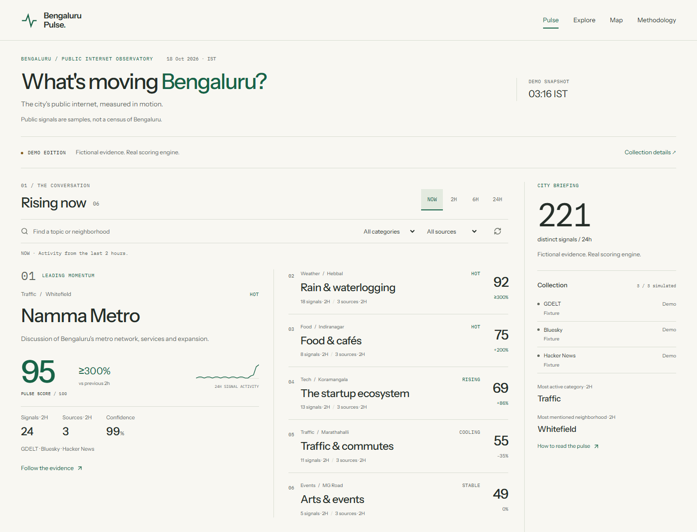
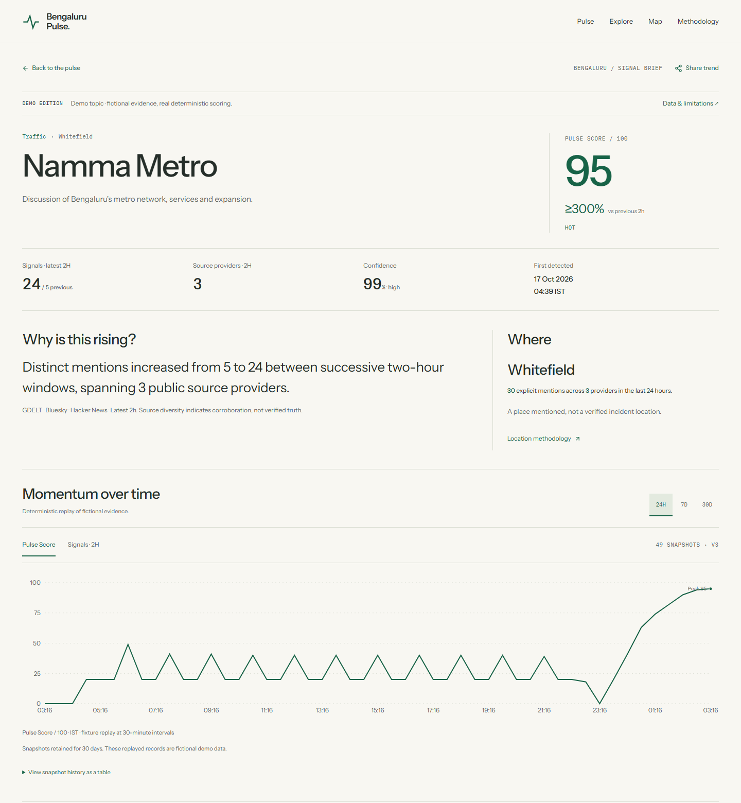

# Bengaluru Pulse

A momentum detector for Bengaluru's public internet, with source evidence behind each topic and score.

[Live site](https://bengaluru-internet-pulse.vercel.app) · [Methodology](docs/trend-algorithm.md) · [Verification](docs/portfolio-readiness.md)




These are real browser captures of the **fictional demo**, not live evidence. Reproduce them with `npm run build` then `npm run screenshot`; [capture details](docs/images/README.md).

## Why I built it

- TODO(author): describe the Bengaluru question that prompted this project.
- TODO(author): describe the use case you wanted to explore.
- TODO(author): explain your contribution and what you learned, in your own words.

## How it works

Public source metadata is validated and deduplicated, then grouped into topics. A local heuristic is the free default; OpenAI and xKiro remain optional. Only the deterministic engine assigns scores, confidence and lifecycle. Public reads use stored snapshots and never start ingestion.

```mermaid
flowchart LR
  cron[GitHub Actions cron] --> worker[Server-only ingestion]
  worker --> sources[Public APIs and optional RSS]
  sources --> validation[Zod validation, deduplication, filter flags]
  validation --> enrichment[Heuristic or optional semantic API]
  enrichment --> scoring[Deterministic scoring]
  scoring --> storage[Turso / local libSQL]
  storage --> api[Read-only API]
  api --> ui[Next.js UI]
```



Scores compare successive two-hour windows using the existing 40/25/20/15 weights for velocity, volume, channel diversity and recency. Sparse evidence is capped; confidence is separate. Jobs and rule-filtered noise stay stored with reasons and do not enter momentum scoring. [Equations and limits](docs/trend-algorithm.md).

## Key results

<!-- EVALUATION_START -->
**Results: TBD (awaiting hand-labeled sample).** [Evaluation method and limits](docs/evaluation.md).
<!-- EVALUATION_END -->

`npm run eval:sample` prepares empty human labels; `npm run eval` updates the measured tables only after labeling. Synthetic fixtures test the evaluator and never count as project results. [Stored-timeline case-study template](docs/case-study-template.md).

## Tech stack

Next.js App Router · React · strict TypeScript · Zod · Turso/libSQL · Tailwind · Recharts/Leaflet · Vitest · Playwright/axe · GitHub Actions · Vercel.

## Run locally

Node.js 22.13+. The default labeled demo needs no accounts, keys or database setup.

```sh
npm ci
npm run build
npm start
```

Open [localhost:3000](http://localhost:3000). For development use `npm run dev`. [Collected-data setup, environment variables and deployment](docs/deployment.md).

## Review the engineering

- [Architecture and boundaries](docs/architecture.md) · [decisions](docs/decisions.md)
- [Sources, failures, filters and RSS terms](docs/data-sources.md) · [locality verification](docs/neighborhoods.md)
- [Semantic enrichment and provenance](docs/enrichment.md) · [atomic persistence and retention](docs/persistence.md)
- [Public API and compatibility](docs/read-api.md) · [topic briefs](docs/topic-detail.md)
- [Checks and remaining external limits](docs/portfolio-readiness.md) · [contributing](CONTRIBUTING.md) · [MIT license](LICENSE)

The previous README's full source is [preserved](docs/readme-before-portfolio.md), including earlier deployment, API, semantic, performance and shipping notes. Current contracts and verification take precedence over historical status observations.

## Known limitations and roadmap

- Public search is sampled. Outages, result caps, language coverage and delayed scheduled runs can leave sparse or stale evidence; the site exposes those gaps.
- Heuristic grouping, categories and content-rule flags need human evaluation. Confidence describes sampled corroboration, not truth or importance.
- Language badges estimate scripts; transliteration and shared scripts remain ambiguous. Locality aliases are mostly English spellings.
- Only nine locality centers are verified. The other 131 stay off maps until reviewed. Map points describe mentions, not verified incidents or people.
- RSS is implemented but off by default until the author reviews unchecked feed terms. GDELT remains an observed timeout/network limitation.
- Next work: complete human labels, evaluate a current collected sample, write a case study from real history, review locality coordinates and feed rights, and measure sustained source coverage. No adoption or accuracy claim is made.
